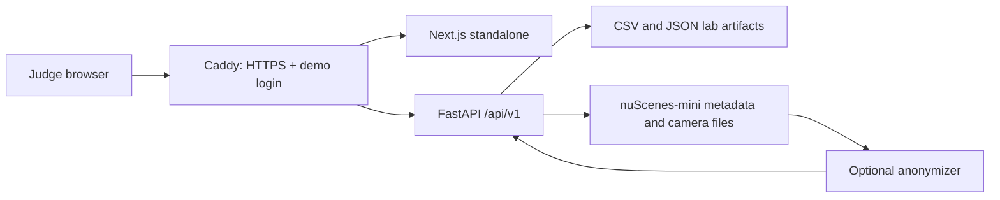

# P-027 Lab architecture

Current implementation: 30/09/2026. Frontend UI remains a Next.js scaffold; the read-only lab API and deployment foundation are implemented.

Data is mounted read-only outside Docker images. Backend does not mount raw data as a static website. Camera endpoints return processed JPEGs only and return 503 when processing is disabled/unavailable. Models load lazily; GPU packages are not required by the web environment.

Implemented API: capabilities, detector registry, mini-val scenes and frames, score-filtered detections, benchmark source data and guarded cameras. Models for frame/detection responses are defined in src/models/lab.py; docs/lab-openapi.json is the generated contract.

Coordinates: ego x forward, y left, z up; meters; yaw radians counterclockwise. sample_token is the API identity; sample_idx is only the mapping into stored CSV. All precomputed detection exports cover mini-val (81 frames, 2 scenes).

Optional research code remains in legacy/streamlit_lab. Its data paths use NUSC_ROOT/LAB_DATA_ROOT; MATLAB_PROJECT_ROOT is required for a separately installed Level 1 project. This code is not automatically executed by public requests.

Not implemented yet: lab UI, point-cloud/GT/occupancy/flow/risk tensor endpoints, batch camera cache, public deployment and live GPU inference. Follow docs/UI_UX_TEAM_PLAN.vi.md for the three-person implementation plan.

CI tests backend and builds frontend. Both jobs target the Phoenix Windows runner using self-hosted, Windows, X64, team-27 labels; deployment is initially manual on a separate server. See docs/DEPLOYMENT.vi.md.
