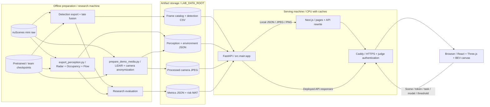

# Architecture · Perception Lab

Đối chiếu code ngày 04/10/2026: **offline inference → artifact theo frame → read-only API → browser renderer**. Model perception không chạy trong mỗi HTTP request. Máy chuẩn bị và máy phục vụ có thể cùng máy trong local.

## Components và data flow

Mũi tên về browser là response data flow. Request routing: [sequence diagram](docs/architecture_diagram.md). Local không cần Caddy: browser → Next `/api/*` rewrite → FastAPI. Compose: Caddy route `/api/*` trực tiếp tới backend, trang tới Next.

## Components thực tế

| Code | Trách nhiệm |
|---|---|
| `frontend/src/components/shell/app-shell.tsx` | Navigation Lab/Compare/Benchmarks, layout. |
| `components/lab/perception-workspace.tsx`, `scene-timeline.tsx` | Shared scene/frame, modes, playback chờ dữ liệu và dừng khi đổi mode/tab ẩn. |
| `sensor-workspace.tsx`, `viewer/PointCloudCanvas.tsx` | Camera 360 và point clouds; tick sensor chỉ ẩn lớp. |
| `viewer/SpatialViewer.tsx`, `BevViewer.tsx`, `PerceptionGrid.tsx` | Detection proxy 3D, BEV, occupancy/flow/semantic points. Seg3D cần artifact thật. |
| `frontend/src/lib/lab-frame-cache.ts` | Bounded browser caches/prefetch; không database. |
| `src/api/lab.py` | HTTP validation, 404/422/503, camera processed-only, risk PNG. |
| `src/services/lab.py` | Catalog/model/CSV adapters, mtime cache, metrics, risk MAT → PNG. |
| `src/services/environment.py`, `perception.py` | Environment và validation token/task/coordinates/geometry/provenance. |
| `src/services/anonymizer.py` | MTCNN face + YOLO plate khi được bật; unavailable thì fail-closed. |
| `scripts/export_perception.py` | Radar alignment, offline occupancy/flow inference và checkpoint provenance. |
| `deploy/compose.yml`, `Caddyfile` | HTTPS/auth gateway, internal services, read-only data mount. |

`src/agent/` và `/api/v1/chat` là scaffold riêng; LLM/LangGraph/PostgreSQL/ChromaDB không trên critical path Lab. Agent chọn trọng số theo thời tiết và mô phỏng thời tiết chưa là tính năng online hiện tại.

## Đồng bộ và diễn giải output

- `exports/L3E/samples.csv` cung cấp scene/index/token/timestamp. Token liên kết các output theo frame.
- **Ego coordinates**: x trước, y trái, z lên; mét; yaw radian CCW. Radar biến đổi calibration/ego pose về frame tham chiếu.
- Detection CSV: `x,y,z,w,l,h,yaw,vx,vy,score,class_name`. API lọc score, không inference lại. CRN camera/radar; LiDAR nền là tham chiếu riêng.
- Occupancy grid 200×200, 0.5 m/cell, extent ±50 m; free/static/object. BEV 2D, không dense voxel 3D.
- Flow vectors `(x,y,vx,vy)` từ temporal checkpoint T4; chất lượng còn yếu.
- Seg3D points `(x,y,z,class_id)`, bảng lớp, `kind=prediction|ground_truth`. Chưa có artifact: 503 và empty state, không dùng proxy thay thế.
- Risk đọc `stage_h/risk_out.mat`, classical/oracle: cùng frame nhưng **không tính lại từ Detection đang chọn**.

## Cache, camera và vận hành

Raw ảnh không mount public/static. Camera chỉ trả processed cache hoặc anonymizer result; không xử lý được thì 503. `X-Anonymized` biểu thị đường phục vụ processed, không chứng minh 100% khuôn mặt/biển số được phát hiện. Review cache trước khi chia sẻ.

Environment cache miss có thể đọc raw LiDAR khi request; camera miss có thể inference khi được bật. Precompute environment và 81×6 camera để tránh tải frame chậm. Dataset/checkpoint giữ ngoài Git. CI không tự deploy; pull/build/restart riêng. [Actual evaluation](eval/results/report.md) chỉ xác nhận môi trường local.
