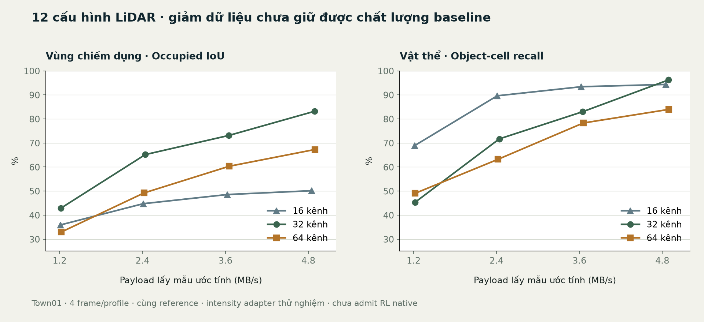

# CARLA native và căn chỉnh đầu vào thử nghiệm

Ngày 13/10/2026, server CARLA 0.9.16 phục hồi đã tạo capture thật trên Town01. Camera RGB 640×360, LiDAR, reference và checkpoint occupancy chạy được. Đây là kiểm chứng tích hợp và chẩn đoán có giới hạn, chưa chứng minh an toàn ADAS hoặc online RL.

## Những gì đã chạy

- FOV 60°, 90°, 110°: mỗi cấu hình 2 frame, sensor ghi đúng FOV; ảnh giải mã được. Occupancy LiDAR không dùng camera nên không lấy metric occupancy để kết luận FOV tốt hơn.
- Capture gần ego: 4 frame, 2 xe có footprint trong vùng đánh giá. Reference có 106 object-cell; đầu vào gốc cho object-cell recall 0%. UI có lớp Reference để thấy rõ bỏ sót.
- Một người đi bộ: smoke 4 frame thành công; không suy diễn thành pedestrian detection benchmark.
- Sương mù và mưa: mỗi môi trường 2 frame. RGB thay đổi nhưng đầu vào LiDAR và metric của hai lần này giống nhau. CARLA WeatherParameters chưa là mô hình suy hao sensor vật lý; không gọi đây là chứng minh độ bền trước mưa/sương mù.
- Các lần Town03 / traffic 8 xe + 8 người gặp SIG11. Giữ trạng thái failed và log; chưa xác định nguyên nhân. Không đưa clip thiếu vào training.

Preset UI chọn Town01, 2 xe, 0 người, 4 frame và spawn gần ego. Guard 10 GiB RAM khả dụng vẫn áp dụng trước khi khởi động simulator. Capture chạy từng job; tiến độ chỉ tăng khi đã ghi cặp camera/LiDAR.

## Vì sao cần kiểm tra intensity

Mức trung bình kênh intensity trên ô có điểm: nuScenes **training split** khoảng 0,05962; 4 frame CARLA calibration khoảng 0,91914. Adapter thử nghiệm dùng một gain cố định 0,0648643347, chỉ nhân kênh intensity. Gain được chốt trước khi xem kết quả hai route mới, không fit từ nhãn và không thay checkpoint.

| Capture đánh giá | Đầu vào | Occupied IoU | Object IoU | Object-cell recall |
| --- | --- | ---: | ---: | ---: |
| Town01 route 17, seed 73 · 4 frame | Gốc | 25,8% | 0% | 0% |
| Cùng capture | Căn chỉnh thử nghiệm | 76,6% | 16,9% | 85,1% |
| Town01 route 31, seed 97 · 4 frame | Gốc | 33,1% | 0% | 0% |
| Cùng capture | Căn chỉnh thử nghiệm | 80,6% | 55,6% | 88,1% |
| Fog / Rain · mỗi capture 2 frame | Gốc | 38,2% | 0% | 0% |
| Cùng capture | Căn chỉnh thử nghiệm | 82,5% | 45,5% | 92,6% |

**Recall cao không đồng nghĩa segmentation hoàn thiện.** Object IoU 16,9% ở route 17 cho thấy vẫn có nhiều ô dự đoán sai. Chỉ 8 frame đánh giá cùng một map; cần map/route/sensor held-out lớn hơn. Reference gồm ô LiDAR quan sát được, proxy static theo chiều cao và footprint actor; không là semantic ground truth toàn cảnh.

Đầu vào gốc là mặc định. Trong form CARLA có lựa chọn căn chỉnh thử nghiệm, chỉ bật khi manifest và checkpoint khớp SHA. Job đóng băng hash lúc enqueue, kiểm tra lại trước capture và trước inference. Không sửa raw NPZ, nhãn, checkpoint hoặc report PPO nuScenes. Dữ liệu native này **chưa được admit cho training RL**.

## Đối chiếu và chạy lại

Trong `/lab`, mở bot → công cụ thí nghiệm. Danh sách có các capture FOV/mưa/sương mù đã chạy; chọn model hoặc Reference, Play/Pause, kéo thanh frame. Bản căn chỉnh là một job khác tái sử dụng đúng capture camera/reference, có adapter SHA riêng. Nút “Chuẩn bị đối chiếu cùng capture” điền cấu hình trước khi bạn tạo lượt đo. Ở Reference, chọn một trong tối đa sáu actor gần nhất để xem viền footprint, khoảng cách 2D tới tâm, phía trước/sau/trái/phải và kích thước. Đây là metadata simulator; không ghép danh tính của actor với pixel camera hoặc gọi footprint là detection của model.

Nguồn evidence nằm ở `eval/recovery-mvp-2026-10-13`:

- `native-fov-captures.json`: FOV thực tế, ảnh, trạng thái smoke.
- `native-pilot-coverage.json`: coverage và các job failed.
- `native-input-domain-diagnostic.json`: thống kê train/calibration.
- `native-intensity-preregistered-plan.json` + `.sha256`: kế hoạch/gain trước evaluation.
- `native-intensity-heldout-evaluation.json` + `.sha256`: confusion matrix và raw SHA trên hai route mới.
- `native-input-{fog,rain}-diagnostic.json` + `.sha256`: kiểm tra bổ sung, không refit.
- `native-input-adapter.json` + `.sha256`: manifest experimental được runtime sử dụng; không là trọng số train mới.
- `native-published-preview.json`: capture/job preview và nguồn raw.

Tái đánh giá capture hoàn chỉnh có sẵn, không khởi động CARLA và không fit lại:

```bash
.venv-recovery312/bin/python -m scripts.evaluate_native_input_adapter \
  data/experiments/<capture-id>/capture \
  --output data/adapter-evaluation-new.json
```

Không ghi đè evidence cũ. Bước tiếp theo là thiết kế split native theo route/map, coverage và reference audit; sau đó thu bộ profile sensor có đo chất lượng/latency. Bộ 12–24 profile và MultiDiscrete trong kế hoạch gốc vẫn chưa hoàn tất. PPO offline 3 mức giữ điểm hiện có là kết quả riêng, không dùng các con số CARLA này để tô lại báo cáo PPO.

## Pilot 12 profile LiDAR vật lý

12 profile = 16/32/64 kênh × 150k/300k/450k/600k điểm/s. Bốn study đã hoàn tất; các baseline lặp lại có cùng reference hash. Audit đọc lại raw điểm/intensity để tái tạo chính xác feature tensor, so input/reference SHA và confusion matrix với prediction lưu. Không nâng 16/32 kênh giả thành 64 kênh.

Ở cùng Town01/seed42, baseline 32 kênh 600k có occupied IoU 83,2%, object IoU 39,8%, object-cell recall 96,2%. 32 kênh 300k: 65,2% / 29,8% / 71,7%; 32 kênh 150k: 42,9% / 18,2% / 45,3%. Theo ngưỡng đã đặt trước đo (occupied ≥50%, object IoU ≥10%, recall ≥50%, occupied IoU giảm tối đa 2 điểm phần trăm), các study giữ baseline. 16 kênh 600k có object IoU cao hơn baseline nhưng occupied IoU chỉ 50,1%: nhiều hoặc ít kênh không tự bảo đảm mọi metric tốt hơn.

Trong bot, mở “12 profile LiDAR · pilot đã đo” để xem matrix và từng metric vật thể. “Kiểm chứng 2 mức LiDAR” tạo ba capture mới không gọi LLM. Evidence có hash, run JSON, thông số, lý do không chọn profile và engineer review; review không tự train lại. Lặp capture phát lại dữ liệu đã ghi, không là mô phỏng trực tiếp.

Nguồn: `native-12-profile-plan.json/.sha256`, `native-12-profile-audit.json/.sha256` và `native-sensor-study-evidence.json`. API đọc `/api/v1/experiments/native-profile-pilot` và `/report` từ artifact allowlist; chưa có hoặc sai checksum thì không hiển thị như evidence hợp lệ.

**Chưa admit cho RL native**: chỉ một route, 4 frame/profile, chưa có train/validation/test tách biệt. Ba profile đầu đã được đo trước mở rộng catalog; không gọi toàn bộ pilot là test chưa từng xem. Baseline hit cache nên p95 của nó trong study này là null, không lấy số đo khác để điền. Payload ước tính từ gói sensor lấy mẫu, không là điện/GPU/chi phí tiền.

Tái audit (không chạy CARLA/model hay training):

```bash
.venv-recovery312/bin/python -m scripts.audit_native_profile_pilot \
  data/runtime/native-12-profile-current.json \
  --plan eval/recovery-mvp-2026-10-13/native-12-profile-plan.json \
  --output data/native-profile-audit-new.json
```

## Liên hệ actor reference giữa BEV và camera

Clip `5e811b1fc4154003bcb34a371b90d83f` có 20 frame với camera pose, world box matrix, FOV và kích thước ảnh được ghi thực. API kiểm tra camera/simulation frame ID, center BEV so với world/ego transform, và tính lại khung chiếu. Không ước lượng calibration của capture cũ.

Trong Reference, chọn actor: viền footprint xuất hiện ở BEV; nếu có phép chiếu hợp lệ, viền sáng xuất hiện trên camera. Actor phía sau không bị vẽ vào camera trước. Đây là hình học tham chiếu theo [hướng dẫn bounding box CARLA](https://carla.readthedocs.io/en/latest/tuto_G_bounding_boxes/), không phải detection ảnh; chưa xét che khuất hoặc méo lens. Vật thể trong occupancy không có instance ID nên không tuyên bố đã ghép model-cell với danh tính trên ảnh.

Clip fog `33443fbf2b254d60a62f9f456565b63c` cũng có 20 frame; chưa có camera projection metadata vì được tạo trước bổ sung này. Cả hai chỉ để demo/review, không admit RL native. SHA ảnh, frame ID và output lưu trong `native-continuous-preview-evidence.json/.sha256`.

Trang đối chiếu baseline/ứng viên phát cặp output + ảnh atomic: giữ cặp trước đến khi cả hai sẵn sàng, cache tối đa 6 cặp, có Play/Pause/Lặp. Camera lỗi không được thay bằng raw hoặc frame khác. Chế độ lặp là replay dữ liệu đã ghi, không là mô phỏng/agent online.


