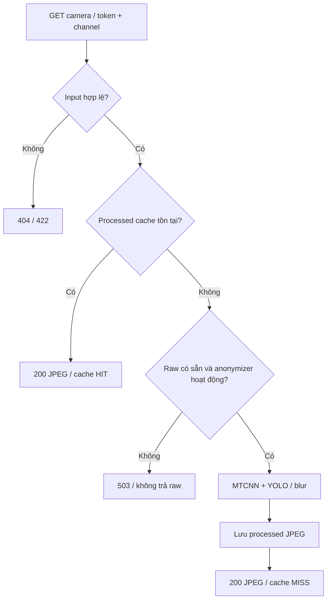
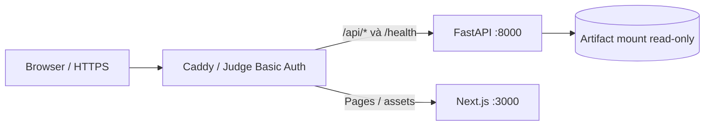

# Request sequence và data contracts

[Sơ đồ components tổng thể](../ARCHITECTURE.md). Luồng MVP thực tế dưới đây thay diagram LLM/vector-store của scaffold.

```mermaid
sequenceDiagram
  actor User
  participant UI as React Lab / Timeline
  participant Cache as Bounded browser cache
  participant Next as Next rewrite
  participant API as FastAPI
  participant Files as LAB_DATA_ROOT artifacts
  User->>UI: Chọn scene / frame / task
  UI->>Cache: Token + task/model + threshold
  alt Cache HIT
    Cache-->>UI: Payload đã nhận
  else Cache MISS
    UI->>Next: GET /api/v1/lab/frames/{token}/...
    Next->>API: Proxy tới API_INTERNAL_URL
    API->>Files: Đọc CSV/JSON theo token và mtime
    Files-->>API: Artifact
    API->>API: Validate geometry/provenance hoặc lọc score
    API-->>Next: 200 JSON hoặc 404/422/503
    Next-->>UI: HTTP response
    UI->>Cache: Lưu thành công / loại entry lỗi
  end
  UI->>UI: Render active viewer / loading / error
  UI-->>User: Quan sát cùng frame
  Note over UI,Files: Perception inference offline; tick sensor không chạy ablation
```

## Camera processed-only



Cache phải được tạo qua bộ lọc, không copy raw JPEG vào processed cache. Bộ lọc có thể bỏ sót; header không phải chứng nhận chất lượng riêng tư.

## Deployed routing



| Output | Nguồn | Endpoint dưới `/api/v1/lab` |
|---|---|---|
| Catalog/models | `samples.csv`, model registry | `/scenes`, `/models`, `/scenes/{id}/frames` |
| Detection | `exports/L3E/pred_*_ego.csv`, `fusion/unified/*.csv` | `/frames/{token}/detections` |
| LiDAR | `cache/environment/{token}.json`; fallback raw LIDAR_TOP | `/frames/{token}/environment` |
| Radar | `cache/perception/radar/{token}.json` | `/frames/{token}/perception/radar` |
| Occupancy/Flow/Seg3D | `cache/perception/{task}/{token}.json` | `/frames/{token}/perception/{task}` |
| Cameras | `cache/cameras/{token}_{channel}.jpg` | `/frames/{token}/cameras/{channel}` |
| Risk | `stage_h/risk_out.mat` | `/frames/{token}/risk` |
| Metrics | `models/.../metrics.json`, risk metrics | `/benchmarks` |

Sau tích hợp main `aa78ba9`, các adapter còn đọc SQLite/PostgreSQL seeded records cho catalog/detections/processed media/benchmark reports, với file fallback. Sequence phía trên thể hiện file path; database reads thay bước đọc file khi adapter chọn DB. Perception JSON và risk MAT không được seed bởi scripts database hiện tại.

Perception artifacts chứa token/task/model/sensors/source và ego coordinates. [Seg3D contract và UI modes](LAB_PERCEPTION_WORKSPACE.vi.md); [real outputs](../eval/results/report.md).
