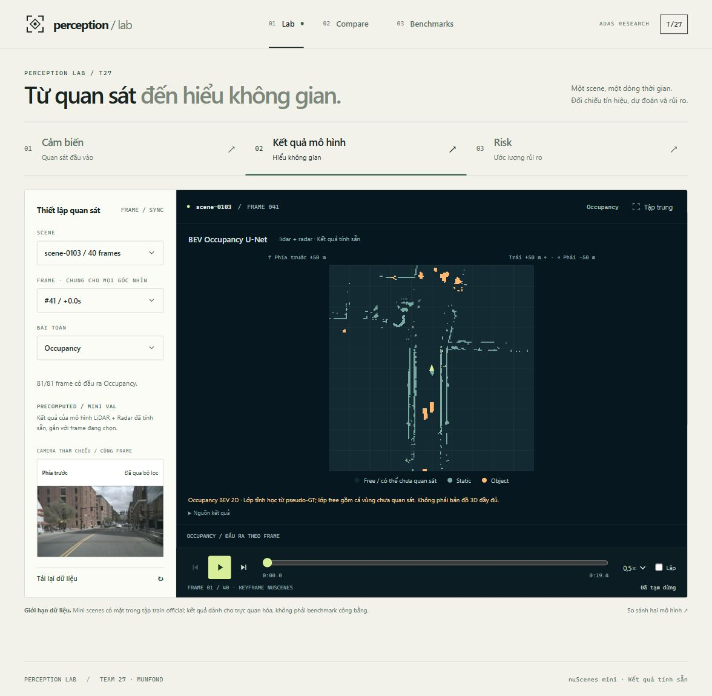

# Actual evidence · 2026-10-04

[Manual protocol và kết quả 12 ca](../../results/report.md).

- `api-probes.json`: 30 responses thực, 28 assertions; body JSON nhỏ lưu đầy đủ, array lớn trích count/3 phần tử; SHA256 + byte count của body đầy đủ.
- `M01`–`M10`: PNG chụp ứng dụng đang chạy và `.txt` DOM với URL/timestamp UTC. Prefix tương ứng case trong report. Đây là ảnh local, không ảnh mockup.
- `M11-camera-failclosed.json`: HTTP 503 từ backend thử riêng, đã dừng.
- `source-fingerprints.json`: hash các source trọng yếu của dirty working tree.
- `manifest.json`: hash/kích thước từng file evidence, để kiểm tra bộ bằng chứng không bị đổi.

Không chứa raw dataset/checkpoint, secret hoặc video lớn. Case thiếu Seg3D có nghĩa empty state đúng, không có nghĩa Seg3D đã chạy. Số liệu ML trong benchmark là artifact có sẵn, không được tái tính trong đợt kiểm thử chức năng.
